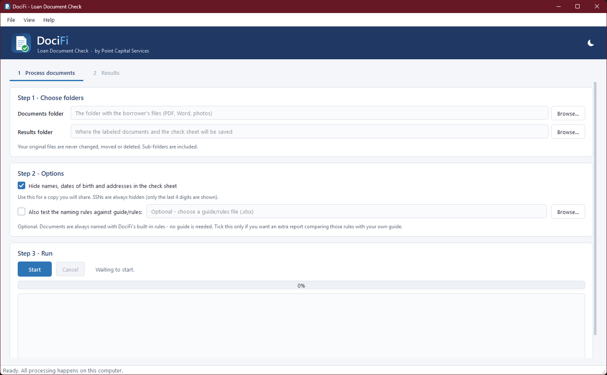
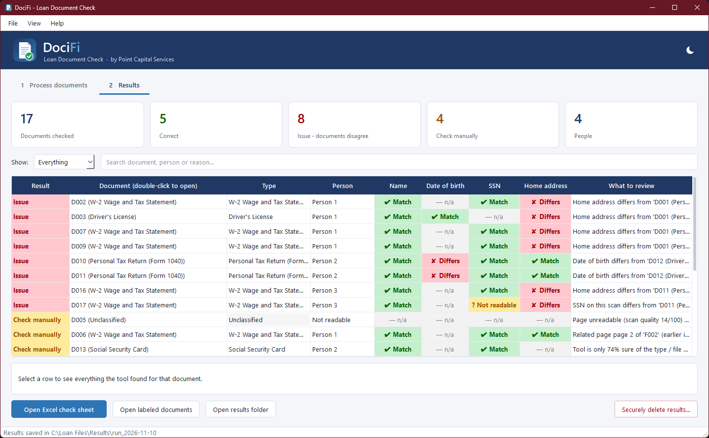
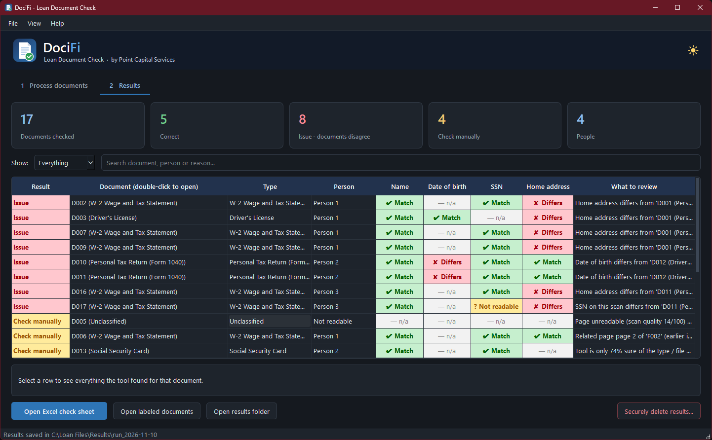
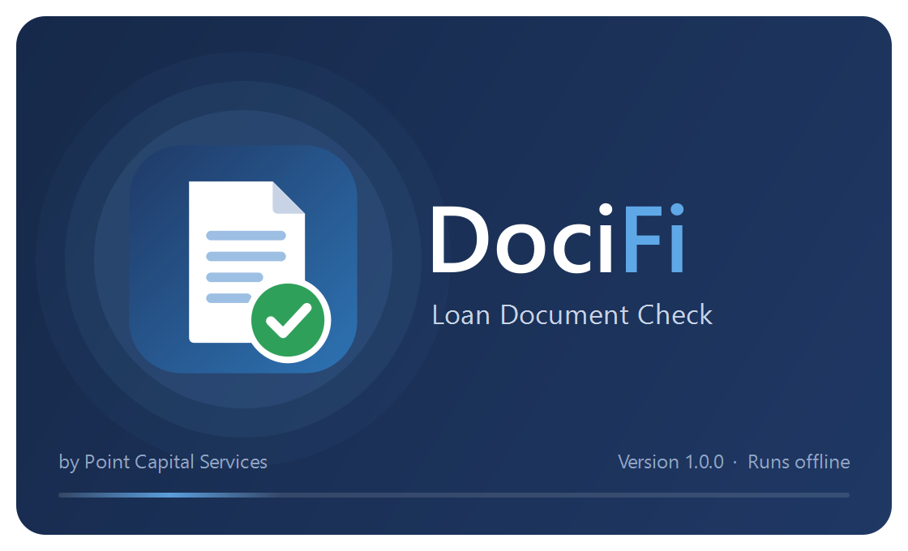

<div align="center">


# DociFi — Loan Document Check

**Turns a folder of mixed borrower documents into correctly named PDFs and a check sheet that shows,
for every document, whether the borrower's Name, Date of Birth, SSN and Address agree, all on the user's own computer.**


[Download](#download-and-run) · [What it does](#what-it-does) · [How it works](#how-it-works) ·
[Tech stack](#technology-stack) · [Build from source](#build-from-source) · [Limitations](#known-limitations) · [Roadmap](#roadmap)

</div>

---

## The problem

A mortgage file arrives as a pile of PDFs, phone photos, Word files and multi-page bulk scans: tax returns
for two years shuffled together, several W-2s, a photocopy with two driver's licences on one page, a blank page.
Before underwriting, someone has to convert everything to PDF, split the scans into individual documents,
name each one by the company's naming rules, and check line by line that the borrower's identity
details are the same on every document. That is slow, repetitive and easy to get wrong.

## What it does

| # | Task | How DociFi handles it |
|---|------|------------------------|
| 1 | **Convert to PDF** | Images (JPG, PNG, TIFF, multi-page TIFF), Word (.docx/.doc via Word or LibreOffice) and text files become PDFs. PDFs are used as they are. |
| 2 | **Split bulk scans** | Every page is read and recognised; pages are regrouped into documents (a 1040 package by tax year in the correct IRS page order, one W-2 per page, continuation pages kept with their document). Several ID cards on one scanned sheet are cut out individually. |
| 3 | **Label documents** | Each document gets a file name built from the configured naming rules, e.g. `Jane - INCOME - W2 - Example LLC - 2024.pdf`, and is saved into a folder per person. |
| 4 | **Check sheet** | An Excel workbook confirms **Name, Date of Birth, SSN and Address** for every document as *Correct*, *Issue* (documents disagree) or *Check manually* (could not be read with enough confidence), and says exactly which document to review and why. |

The original files are never modified, moved or deleted.

## Screenshots

<table>
<tr>
<td width="50%"></td>
<td width="50%"></td>
</tr>
<tr>
<td align="center"><sub>Three steps: choose folders, options, run</sub></td>
<td align="center"><sub>Every document with its Name / DOB / SSN / Address result</sub></td>
</tr>
<tr>
<td width="50%"></td>
<td width="50%"></td>
</tr>
<tr>
<td align="center"><sub>Dark mode (follows Windows, or switch in the header)</sub></td>
<td align="center"><sub>Animated start-up screen</sub></td>
</tr>
</table>

<sub>Screenshots come from a real run with *Hide personal values* switched on; person initials were replaced with "Person 1…n".
No client data is stored in this repository.</sub>

## Download and run

1. Download **`DociFi.exe`** from the [latest release](../../releases/latest).
2. Double-click it. There is no installer and no setup: Python, both OCR engines and the rules are inside the one file.
3. Choose the folder with the borrower's documents and a results folder, then press **Start**.

> The .exe is not code-signed yet, so Windows SmartScreen may show *"Windows protected your PC"* the first time.
> Choose **More info → Run anyway**. Code signing is on the [roadmap](#roadmap).

Results are written to a new, dated folder each run:

```
Results/run_2026-11-10_204438/
├── Check_Sheet.xlsx          the check sheet (8 tabs, print-ready)
├── documents/                labeled PDFs, one folder per person
│   ├── <Person A>/  ...pdf
│   └── _Needs review - unrecognised pages/
├── converted/                non-PDF originals converted to PDF
├── logs/audit.jsonl          audit trail (IDs and outcomes only, no personal data)
└── run_summary.json
```

### The check sheet

| Tab | Contents |
|-----|----------|
| **Document Check** | One row per document: result, clickable file name, type, person, ✔ / ✘ / ? for Name, DOB, SSN, Address, and what to review. Issues first. |
| **People** | Each person found, the reference value chosen for each field and which documents it came from. |
| **Review Queue** | Everything that needs a human, by priority, with *Reviewed by / Date / Outcome* columns for sign-off. |
| **Duplicates** | Possible duplicates. These are flagged, **never deleted**. |
| **Files / Pages** | Every input file and page: how it was read, reading quality, and where it ended up. |
| **Self-Test** | Optional: the naming rules tested against a guide/rules workbook. |
| **About** | Run details, settings and how to read the sheet. |

SSNs are always masked (`***-**-1234`) in the sheet, on screen, in logs and in the console.

## How it works

```mermaid
flowchart LR
    A[Input folder] --> B[Discover and fingerprint<br/>SHA-256, exact duplicates]
    B --> C[Convert to PDF]
    C --> D[Read every page<br/>text layer, else Tesseract OCR<br/>with rotation and clean-up retries]
    D --> E{Quality low or<br/>value missing?}
    E -- yes --> F[Second reading<br/>RapidOCR, ONNX, offline]
    E -- no --> G
    F --> G[Recognise page type<br/>YAML rules]
    G --> H[Assemble documents<br/>group by year, IRS page order,<br/>split ID cards]
    H --> I[Extract Name / DOB / SSN / Address]
    I --> J[Group people and verify<br/>reference value per field]
    J --> K[Label and save PDFs]
    J --> L[Excel check sheet<br/>review queue, audit log]
```



**Reading.** Digital PDFs use their text layer directly. Scanned pages go through Tesseract with automatic
orientation detection. When the result is weak the page is cleaned (deskew, threshold, denoise) and read again,
including all four rotations if needed. Only when quality is still low, or a needed value is missing, does a second,
independent engine (RapidOCR) read the page. This keeps the first run fast while still recovering hard pages.
All readings are cached, so a repeat run on the same files takes seconds.

**Recognising documents.** Document types, keywords, page order, field locations and file-name templates live in
[`app/config/document_types.yaml`](app/config/document_types.yaml), not in code. Each type has
required phrases, weighted keywords, exclusions, a minimum score and a priority. Continuation pages
(W-2 instructions, 1040 schedules) are recognised first so they stay with their parent document.

**Verifying.** Documents are grouped into people (full SSN, or same last four digits plus a matching first name,
tolerant of one OCR digit error). For each field a *reference value* is chosen from the most trustworthy single
source (a driver's licence outranks a W-2 for date of birth, for example), and every document is compared with it.
A difference becomes **Issue**; a value that could not be read reliably becomes **Check manually**. A one-digit SSN
difference on a scanned page is treated as a probable misread (*Check manually*), not a mismatch.
Home address and property address are checked separately.

**Confidence.** Every document carries a confidence score built from page reading quality and field-reading
confidence. Anything below the configured threshold goes to the review queue instead of being silently accepted.

## Engineering highlights

- **Privacy by design.** No network calls anywhere in the code. SSNs are masked at the data-model level.
  The audit log has a block-list for personal fields, so a name, date of birth, SSN or address cannot be written
  to it even by mistake. An optional *redact* mode hides all personal values in the sheet for a shareable copy.
- **Rules as data.** A new document type or a changed naming convention is a YAML edit, not a code change.
  `selftest` checks the rules against a guide workbook and lists every difference.
- **Safe by default.** Originals are read-only. Duplicates are flagged, never deleted. Secure delete only
  works on folders DociFi created (marker file), refuses system and protected folders, and needs the folder name
  typed back to confirm.
- **Two OCR engines, both local.** Tesseract (classic, fast) plus RapidOCR (deep-learning, ONNX Runtime). The
  second engine runs only when needed. Its models ship inside the package, so it never downloads anything.
- **Engine first, UI second.** The same engine powers the desktop app and a command-line interface
  (`DociFi.exe run --input … --output …`), so it can be scripted, scheduled or wrapped in a service later.
- **Tested.** 123 automated tests: unit tests, end-to-end tests with broken, locked, blank, Unicode-named and
  zipped files, and regression tests for every real-world problem found while auditing results against the page
  images. All test values are invented. Linted with Ruff.
- **Reproducible build.** Pinned dependencies and a one-command build (`build_exe.py` + a PyInstaller spec)
  that produces the single-file executable with Tesseract bundled.
- **Professional desktop UX.** Animated start-up screen, light and dark themes, keyboard shortcuts, a results
  table with filters, search and a details panel, double-click to open any document, first-run environment check,
  and remembered window size and folders.

### Measured performance

Measured on one PC (AMD Ryzen 5 5600, 16 GB RAM, Windows 11) with a real sample loan file of 12 input files
and 83 pages (28 digital, 55 scanned):

| Measurement | Result |
|---|---|
| First run (cold, all pages read with OCR) | 5–6 minutes (302–378 s over several runs) |
| Repeat run on the same files (cached readings) | about 2 seconds |
| `DociFi.exe` start-up: splash visible / main window ready | 0.8 s / about 5 s |
| `DociFi.exe` size | 182 MB (single file, everything included) |

OCR accounts for about 84% of the first-run time. Everything else takes under a second.
These are measurements on one machine and one document set, not guarantees.

## Technology stack

| Area | Technology | Why |
|---|---|---|
| Language | Python 3.14 | Mature document, imaging and OCR ecosystem |
| PDF | PyMuPDF | Fast rendering, text layer, page assembly and cropping; isolated in one module (`pdf_backend.py`) |
| OCR | Tesseract 5.4 (bundled) + pytesseract | Proven offline OCR with orientation detection |
| Second OCR | RapidOCR on ONNX Runtime | Independent deep-learning reader for hard pages and photos |
| Imaging | OpenCV (headless), Pillow, NumPy | Deskew, threshold, denoise, card detection |
| Matching | RapidFuzz | Fuzzy name and address comparison tolerant of OCR noise |
| Rules | YAML (PyYAML) | Document types and naming templates editable without code |
| Report | openpyxl | Formatted, print-ready Excel check sheet |
| Word files | Microsoft Word (COM, pywin32) or LibreOffice (headless) | .docx/.doc to PDF |
| Desktop UI | Qt 6 / PySide6 | Native Windows look, light and dark themes, vector-drawn branding |
| Packaging | PyInstaller (single-file, custom spec) | One .exe, no installer |
| Quality | pytest, Ruff | 123 tests, lint-clean |

## Project structure

```
├── app/
│   ├── config/                 document_types.yaml (types, keywords, labels), rules.yaml (thresholds)
│   ├── src/pcs_tool/
│   │   ├── engine/             convert, ocr, ocr_second, classify, assemble, cards, extract,
│   │   │                       normalize, verify, label, report, selftest, pipeline, pdf_backend
│   │   ├── ui/                 main window, splash, themes, dialogs, background worker, vector logo
│   │   ├── cli.py              command line: run / selftest / envcheck / secure-delete
│   │   ├── privacy.py          masking and redaction helpers
│   │   ├── audit.py            JSONL audit trail without personal data
│   │   └── secure_delete.py    guarded overwrite-and-delete of result folders
│   ├── tests/                  123 tests (invented values only)
│   ├── packaging/DociFi.spec   PyInstaller build definition
│   └── scripts/                build_exe.py, make_icon.py, entry point
└── docs/                       architecture, design decisions, images
```

More detail: [docs/ARCHITECTURE.md](docs/ARCHITECTURE.md) · [docs/decisions.md](docs/decisions.md)

## Build from source

Requirements: Windows 10/11, Python 3.14, Tesseract 5 (`winget install UB-Mannheim.TesseractOCR`).
LibreOffice is optional, for Word files on PCs without Microsoft Word.

```powershell
py -3.14 -m venv app\.venv
app\.venv\Scripts\python.exe -m pip install -r app\requirements.txt
app\.venv\Scripts\python.exe -m pip install --no-deps rapidocr-onnxruntime==1.2.3
app\.venv\Scripts\python.exe -m pip install --no-deps -e app

app\.venv\Scripts\docifi.exe                     # desktop app
app\.venv\Scripts\docifi-cli.exe run --input "C:\Loan Files\Borrower" --output "C:\Loan Files\Results"
app\.venv\Scripts\python.exe -m pytest app       # tests
app\.venv\Scripts\python.exe app\scripts\build_exe.py   # -> app\dist\DociFi.exe
```

`rapidocr-onnxruntime` is installed with `--no-deps` on purpose: its dependency list pulls in the full
`opencv-python`, which conflicts with `opencv-python-headless`.

## Known limitations

DociFi reduces manual work. It does not replace a final human check, and it does not promise zero mistakes.

- **Only partly proven on real files.** The rules cover 17 document types (16 naming rules plus SSN cards), but
  the sample file contained 4 of them (1040, W-2, driver's licence, SSN card). Reading of
  the other types (bank statements, paystubs, insurance, mortgage statements, contracts, business returns …) is
  configured but **not yet tested on real documents**.
- **Thresholds come from a small sample.** Confidence and matching thresholds were tuned on one loan file and
  need validation on more files.
- **Very poor scans** (faint, heavily skewed or handwritten) may be unreadable. They go to *Check manually* and are
  never guessed.
- **First run is OCR-bound** (minutes, not seconds, for scan-heavy files). Repeat runs are fast.
- **Word files** need Microsoft Word or LibreOffice on the PC. Without either, they are listed for review.
- **Secure delete** overwrites files before removing them, but on SSDs this cannot guarantee every physical copy is
  gone. Full-disk encryption (BitLocker) is the reliable protection.
- **Licensing before sale.** PyMuPDF is AGPL-licensed. Before selling DociFi, either buy Artifex's commercial
  licence or swap the backend (it is isolated in `pdf_backend.py`). The product name also needs a trademark
  check, since similarly named products exist.

## Roadmap

| Version | Focus |
|---|---|
| **1.1** | Validate on 20–30 more real loan files; tune thresholds; add tests for every newly covered document type; code-sign the .exe |
| **2.0** | Watch-folder / batch mode for many borrowers; per-company naming profiles; editable rules screen in the app; PDF-backend swap for commercial licensing |
| **3.0** | Optional on-premises server edition for a team (still no cloud); integration with the loan origination system through exports |

## Security and privacy

See [SECURITY.md](SECURITY.md). In short: everything runs locally, nothing is uploaded, SSNs are always masked,
and no personal data is written to logs. Real client files are excluded from this repository by
[`.gitignore`](.gitignore) and were checked by an automated scan before publishing.

## License

Copyright © 2026 Sheikh Muhammad Amjad. All rights reserved. See [LICENSE](LICENSE).
Third-party components and their licences: [THIRD_PARTY_NOTICES.md](THIRD_PARTY_NOTICES.md).

Built as a technical assessment for **Point Capital Services**.
