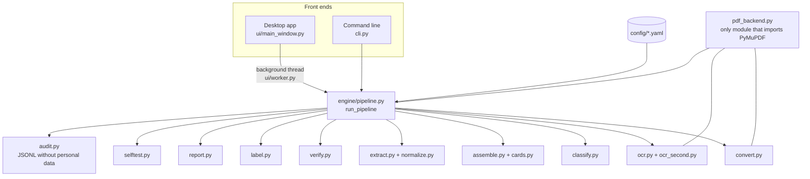

# Architecture

DociFi is built as an **engine** (pure Python, no UI) with two thin front ends: a desktop app and a command line.
Everything the user sees in the app is produced by the same `run_pipeline()` call that the CLI uses.

## Pipeline stages

| Stage | Module | Input → Output |
|---|---|---|
| Discover | `pipeline.discover` | Folder → `SourceFile` list with SHA-256 fingerprints; exact copies detected; spreadsheets and system files skipped |
| Convert | `convert.py` | Images / Office / text → PDF (Word via COM, LibreOffice headless as fallback). Failures become plain-English problems, never crashes |
| Read | `ocr.py` | Page → `PageReading` (text, method, quality 0–100, rotation, image hash). Text layer first; Tesseract with OSD; clean-up retry; all-rotation retry; sparse-text pass. Run in parallel worker processes. Cached per file hash + page + settings |
| Second reading | `ocr_second.py` | Only for pages below the quality threshold or with a missing value: RapidOCR (ONNX) reading, kept alongside the first |
| Recognise | `classify.py` | Page text → document type + score, using weighted keywords, required phrases, exclusions and priorities from YAML. Continuation pages are tested first |
| Assemble | `assemble.py`, `cards.py` | Pages → `Document`s: single-page, contiguous or grouped (folder + tax year, IRS page order). ID cards on one sheet become separate documents via a clip region |
| Extract | `extract.py`, `normalize.py` | Document → fields by *kind* (person name, SSN, date, address, employer, year …) and `PersonRecord`s (role, name, SSN, DOB, address) |
| Verify | `verify.py` | All documents → people (grouping by SSN / last-4 + first name) → reference value per field from the most trusted source → `Check` per field and document |
| Label | `label.py` | Template + fields → file name (`{employee_name\|first} - INCOME - W2 - {employer} - {year}`), filters for first name, title case, last 4, date styles |
| Write | `pipeline._write_documents`, `report.py` | Labeled PDFs per person; Excel check sheet; `run_summary.json`; audit log |

## Data model (`models.py`)

`SourceFile` → `Page` → `Document` (with `fields`, `persons`, `checks`, `confidence`, `review_reasons`) →
`RunResult` (documents, people, stats, paths). `Status` is one of *Correct*, *Issue*, *Check manually*,
*Not applicable*. A document's result is its worst field status.

## Extension points

- **New document type or naming change:** add or edit a block in `config/document_types.yaml`
  (classification, assembly mode, fields with their kind and anchors, persons, label template, verify flags).
- **Thresholds:** `config/rules.yaml` (OCR quality, second-reading trigger, confidence for auto-accept,
  name/address match thresholds, worker count).
- **Different PDF library:** replace `engine/pdf_backend.py` (page count, text, render, image → PDF, assemble).
- **Another OCR engine:** `ocr_second.read_image(img) -> (text, quality)` is the whole interface.

## Desktop app

`ui/app.py` shows the animated splash immediately and imports the engine on a background thread.
`ui/worker.py` runs the pipeline in a `QThread` and reports weighted progress per stage; cancelling stops after
the current page. Themes are style-sheet palettes (`ui/style.py`, `ui/theme.py`); the logo is drawn as vectors
(`ui/brand.py`), so the same drawing produces the splash, the header and the `.ico` file.

## Packaging

`app/scripts/build_exe.py` copies only the Tesseract run-time files (program, DLLs, `eng` + `osd` data), renders
the loader image from the splash animation, writes Windows version information and runs PyInstaller with
`app/packaging/DociFi.spec`. The spec drops unused Qt modules, video codecs and PyMuPDF's optional layout models
(304 MB → 182 MB). At start-up the .exe's loader shows the first splash frame while it unpacks; the animation then
continues from that frame.
